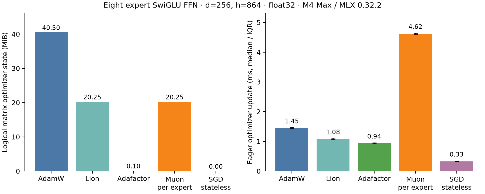

> Public archival copy. Paths and operational metadata were sanitized; original decisions and numerical failures are retained. See the root REPRODUCIBILITY.md for export and reproduction limits.

# Does the optimizer change the MoE result?

Yes for optimizer state, update cost, and potentially learning. It does not
change the ordinary autodiff result: unselected experts still receive full-shaped
gradients in the measured MLX implementation. The original training pilot used
AdamW only; its small loss differences do not establish the result under Muon.

Completed **37 optimizer microbenchmark cases**, with numerical checks, on the
same M4 Max / MLX 0.32.2 environment. No new language-model training was launched.
The original experiment source and BoothGPT checkout were preserved.

## Measured state and update cost

The following table is **one eight-expert SwiGLU FFN only**, d=256, h=864,
float32, three expert-weight stacks, all experts with nonzero gradients.
Weights occupy 20.25 MiB; ordinary gradients occupy another 20.25 MiB.
These are eager, synchronized optimizer-only times, excluding forward/backward.
They are not complete training-step times or convergence comparisons.

| Optimizer | Matrix state, logical MiB | State retained, physical MiB | Median update ms | Update IQR ms |
|---|---:|---:|---:|---:|
| AdamW | 40.50000 | 40.50001 | 1.447 | 1.437–1.464 |
| Lion | 20.25000 | 20.25001 | 1.080 | 1.057–1.113 |
| Adafactor, no first moment | 0.10254 | 0.11720 | 0.936 | 0.922–0.952 |
| SGD, momentum 0.95 | 20.25000 | 20.25001 | 0.549 | 0.520–0.615 |
| Stock SGD, momentum 0 | 20.25000 | 20.25001 | 0.327 | 0.315–0.334 |
| Stateless SGD control, momentum 0 | 0.00000 | 0.00001 | 0.330 | 0.326–0.335 |
| Per-expert batched Muon | 20.25000 | 20.25001 | 4.624 | 4.604–4.640 |

Physical state includes 12 bytes of global step/rate state. Stacked Adafactor
also retains about 15 KiB beyond its logical row/column arrays, reflecting
allocator/layout overhead. Its factored state is 107,520 logical bytes:
3 × 8 × (864 + 256) × 4. Neither the embedding/head, attention, norms, router,
activations nor transient update buffers are included in this table.

Muon and Lion use one weight-sized momentum buffer versus AdamW's two buffers.
Thus Muon halves **optimizer state**, not total training memory. For the isolated
FFN's weights + ordinary gradients + state, that changes 81 MiB to 60.75 MiB
(25% reduction), before activations/transients. Adafactor without a first moment
is the strongest measured state-memory reduction here. Its factored second
moment follows the [Adafactor paper](https://arxiv.org/abs/1804.04235);
this does not show equal learning quality to AdamW or Muon.

Lion uses a momentum/sign update; its single-buffer design is described in the
[authors' implementation](https://github.com/google/automl/blob/master/lion/lion_pytorch.py).
It needs its own learning-rate/decay tuning. No optimizer quality is inferred
from its lower update time here.

Plain SGD mathematically needs no momentum state. Unexpectedly, MLX 0.32.2's
stock SGD initializes an unused full velocity buffer even at momentum=0.
The separately preregistered allocation-only subclass omits that buffer and
produced bit-identical weights over three verified steps. It retained just
12 bytes of global optimizer state. This is an implementation-specific finding,
not a claim that other SGD implementations allocate unnecessary state.

## Does selecting fewer experts reduce optimizer work?

With independent matrices, one dense FFN versus eight-expert optimizer trees:

| Optimizer | Dense FFN ms | E=8, all active ms | E=8, only one active ms |
|---|---:|---:|---:|
| adamw | 0.359 | 1.263 | 1.258 |
| lion | 0.383 | 0.964 | 0.971 |
| adafactor | 0.669 | 2.118 | 2.022 |
| momentum_sgd | 0.260 | 0.530 | 0.521 |
| muon | 1.230 | 8.948 | 9.076 |
| stateless_sgd | 0.207 | 0.474 | 0.391 |

The one-active cases have seven experts with zero task gradients throughout.
The standard full-tree optimizer still visits all matrices and retains the same
state footprint. Batched per-expert Muon took 4.624 ms with all active and
4.636 ms with one active; its batching reduced the cost relative to 24 separate
matrix updates (8.948 ms all active), but did not make updates sparse.

A separate previously-active-then-zero-gradient check confirmed nonzero weight
changes for Muon, momentum SGD, AdamW and Lion, even with weight decay zero.
Skipping an empty expert would therefore alter these optimizers' semantics.
Plain SGD and no-first-moment Adafactor did not change weights in that check;
Adafactor still updates its second-moment state, so skipping it is not generally
an equivalent state update either. Sparse expert clocks or lazy state decay
require an explicit design and validation.

The original router pilot touched all eight experts in the median sampled batch
for both Top-1 and Top-2. Per-token sparsity does not imply that most experts
are absent from the entire optimizer step.

## Muon has an expert-layout trap

In the [pinned MLX 0.32.2 source](https://github.com/ml-explore/mlx/blob/v0.32.2/python/mlx/optimizers/optimizers.py),
stock Muon reshapes any tensor with more than two dimensions to
`(shape[0], -1)` before Newton–Schulz iteration. For `[E, h, d]`, this is
`[E, h*d]`: experts become rows of one jointly orthogonalized matrix. That is
different from applying Muon to each expert's `[h, d]` matrix.

Numerical diagnostic: changing only expert one's gradient changed expert zero's
stock-stacked Muon update by **15.13%** in relative norm. The adapter which
orthogonalizes each final-two-dimensional matrix independently gave exactly zero
cross-expert change. Over three steps at the real benchmark dimensions,
batched versus independent 2-D Muon weight differences were at most
2.53e-7 in relative norm. Those numerical checks passed.

Stock stacked Muon took 5.654 ms in this probe, but its different update rule
makes it an invalid substitute in a fair per-expert comparison. The trap is
specific to this implementation; verify tensor semantics in any other Muon.
The adapter is a research control, not an adopted training recipe.

Stock MLX Muon also implements coupled L2 decay before orthogonalization;
the existing BoothGPT hybrid adds decoupled decay. All current measurements
explicitly set decay to zero, so these timing/state checks do not compare those
different decay recipes. The original hybrid uses `mlx_optimizers.Muon`, whereas
this probe measures built-in `mlx.optimizers.Muon` from MLX 0.32.2.

BoothGPT's current hybrid optimizer (local resource omitted)
validates a role-based list of approved 2-D hidden matrices. The research MoE
needs explicit expert ownership: its 3-D stacks are not eligible 2-D matrices,
and independent expert names are outside the current role list. Copying the
existing hybrid configuration alone is insufficient. Embeddings/head/norms and
the router should have an explicitly assigned AdamW branch. Muon's original
[author guidance](https://kellerjordan.github.io/posts/muon/) also distinguishes
hidden matrices from input/output and scalar/vector parameters.

## Gradient result remains unchanged

Rechecked the full nn.Module SwiGLU backward pass before optimizer creation:

| Fixed one-expert route | Logical gradient MiB | Physical retained gradient MiB |
|---|---:|---:|
| Ordinary autodiff | 20.25 | 20.25 |
| Custom VJP with broadcast zeros | 20.25 | about 2.53 |

Losses were identical. The custom-VJP gradient memory result reproduces the
previous fixed-route proof. Exact physical-byte deltas depend on allocator
bookkeeping; the logical shape and approximately eightfold retention reduction
are the relevant result. Changing the optimizer does not change which arrays
the ordinary backward pass creates. Selecting gradient subtrees/custom backward
and designing the optimizer's expert-state behavior remain separate tasks.

## What to test next

The original gradient/storage conclusion stands; the optimizer-memory budget
should be updated. The original AdamW-only learning pilot cannot determine
whether Muon changes MoE's learning efficiency.

The next learning comparison should include dense + AdamW, Top-1 + AdamW,
dense + hybrid Muon/AdamW, and Top-1 + hybrid Muon/AdamW. Use verified per-expert
Muon semantics, explicit parameter ownership, independent Muon and AdamW peak
rates with synchronized schedules, bounded tuning for both recipes, enough fresh
tokens to expose learning, and both equal-token and equal-wall-time validation.
Measure the whole model because embedding/head state and attention updates
remain substantial. Include an Adafactor memory-oriented candidate if optimizer
state is the limiting resource; Lion is another simple single-buffer candidate.
Do not scale model capacity from these optimizer microbenchmarks alone.

## Reproduction and provenance

Run from `/RESEARCH_ROOT`:

```sh
.venv/bin/python research/moe-night/results/2026-10-04-optimizers/run_optimizer_probe.py
.venv/bin/python research/moe-night/results/2026-10-04-optimizers/stateless_sgd_probe.py
.venv/bin/python research/moe-night/results/2026-10-04-optimizers/make_report.py
```

These commands overwrite only this follow-up's metric/report outputs; copy the
follow-up directory first if preserving a repeat separately. Source checks use
`FREEZE.json` and `STATELESS_FREEZE.json`, including hashes of the imported
previous experiment code and installed optimizer implementation.

The first probe had 32 cases and the amended SGD control five. Each case used
one first call, three additional warmups, and fifteen measured windows. Timings
include Python graph construction and synchronized MLX evaluation; gradients are
fixed synthetic inputs. Muon uses momentum=.95, Nesterov=True, five NS iterations;
AdamW uses betas=(.9,.95), Lion defaults=(.9,.99), SGD momentum=.95 or0,
Adafactor disables parameter scaling/relative step/first moment. Rates are .02
for Muon and .001 for the others, for this update-cost probe only. They do not
form comparable training recipes.

Memory/cache guards were 16 GiB/1 GiB. Pre/postflight found no other substantial
local ML job and 91% system-wide free-memory percentage. All numerical checks
passed. Raw windows, state shapes, physical deltas and preflight records are in
`metrics.json` and `stateless_sgd_metrics.json`; the preregistration and amendment
are retained alongside them. No protected bank, existing checkpoint, service,
dataset or production job was touched.


