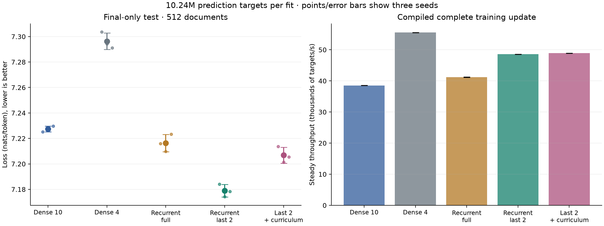
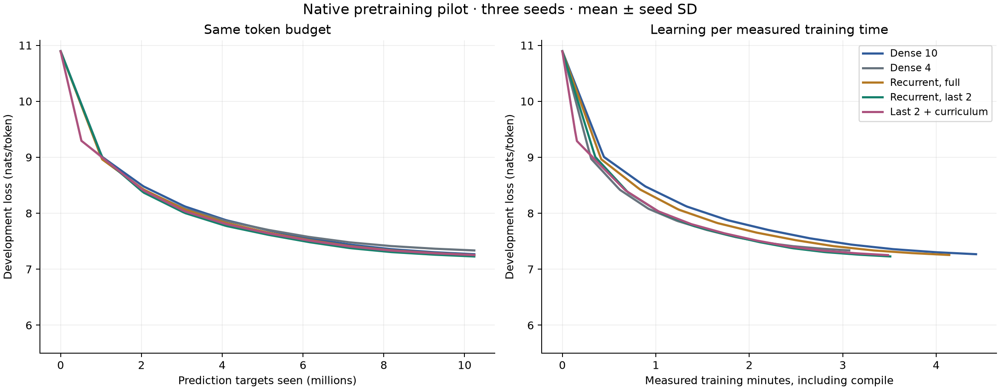
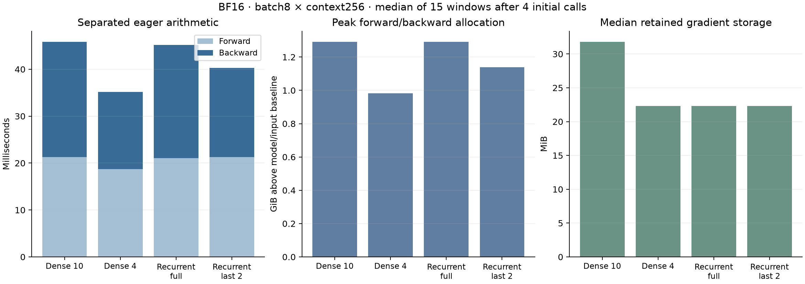
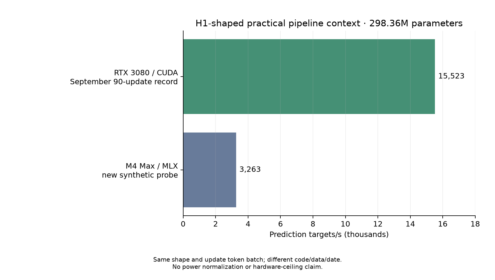

> Public archival copy. Paths and operational metadata were sanitized; original decisions and numerical failures are retained. See the root REPRODUCIBILITY.md for export and reproduction limits.

# Recurrent Depth with Truncated Backpropagation

## Executive answer

Completed **15 primary fits**, three seeds per variant, **10.24M prediction
targets per fit**; **153.6M primary targets** in total. All final checkpoints and
frozen inputs passed integrity checks. No production code, data or job changed.
BitNet was excluded as requested.

Backpropagating through the last two of four shared-core loops delivered
**18.0% higher steady training throughput** than full recurrence and
**15.2% less measured training time** at the same token budget. Its final
test difference was **-0.0374 nats/token** versus full recurrence; positive
means higher loss. This is the direct registered truncation comparison.

The separated eager audit found **21.1% less backward time** and
**10.7% less forward-plus-backward time**. Truncation preserved all
forward loops and the unique gradient tensor sizes. It reduced activation/backward
cost rather than creating sparse recurrent-weight gradients.

Fixed-depth truncation also has the lowest final test loss of all five variants,
and the lowest development loss at the common measured training-time endpoint in
all three seeds. The curriculum did not improve it. **CONTINUE with a registered
follow-up**, including a clipping ablation before extrapolating its quality gain.
This is a short native-pretraining pilot on an old v7 mix, not a capability test
or evidence for changing the existing 298M model.

## Registered learning comparison

All cells are mean ± sample SD across seeds 42/43/44. Throughput includes the
compiled forward, backward, clipping and optimizer update; first 50 calls of each
compiled depth path are excluded only from steady timing. Training time includes
those calls and compilation. Process time comes from controller start/end events
and includes model/data initialization, evaluation and saving. Peak is MLX active
allocation, not total macOS RAM or a cross-backend memory metric.

| Variant | Unique params | Steady k targets/s | Train sec incl compile | Process sec | Peak active GiB | Final test loss |
| --- | --- | --- | --- | --- | --- | --- |
| Dense 10 | 16.668M | 38.53 ± 0.03 | 265.8 ± 0.2 | 270.4 ± 0.2 | 1.880 ± 0.000 | 7.227 ± 0.002 |
| Dense 4 | 11.700M | 55.54 ± 0.05 | 184.4 ± 0.2 | 188.9 ± 0.2 | 1.650 ± 0.001 | 7.296 ± 0.007 |
| Recurrent full | 11.700M | 41.17 ± 0.07 | 248.7 ± 0.4 | 253.0 ± 0.4 | 1.859 ± 0.000 | 7.216 ± 0.007 |
| Recurrent last 2 | 11.700M | 48.57 ± 0.07 | 210.8 ± 0.3 | 215.1 ± 0.3 | 1.736 ± 0.000 | 7.179 ± 0.005 |
| Last 2 + curriculum | 11.700M | 48.89 ± 0.02 | 209.2 ± 0.1 | 213.8 ± 0.1 | 1.736 ± 0.000 | 7.207 ± 0.006 |



| Variant | Final dev loss | Dev at common training time | Dev at common elapsed checkpoint time |
| --- | --- | --- | --- |
| Dense 10 | 7.268 ± 0.004 | 7.445 ± 0.003 | 7.439 ± 0.003 |
| Dense 4 | 7.335 ± 0.005 | 7.335 ± 0.005 | 7.335 ± 0.005 |
| Recurrent full | 7.254 ± 0.007 | 7.381 ± 0.006 | 7.377 ± 0.006 |
| Recurrent last 2 | 7.228 ± 0.005 | 7.272 ± 0.005 | 7.270 ± 0.005 |
| Last 2 + curriculum | 7.252 ± 0.011 | 7.293 ± 0.010 | 7.292 ± 0.010 |

Common training-time endpoints are the shortest completed training duration within
each seed: seed 42: 184.4s, seed 43: 184.5s, seed 44: 184.2s. Development losses there are linearly interpolated between
logged evaluations. The separate elapsed-checkpoint comparison includes validation
and Python overhead. Neither table is an additional test evaluation or a matched
wall-budget retraining: the cosine schedule is defined by tokens, so the faster
run reaches its cooldown sooner. Evaluation spacing is 500 updates (1.024M targets),
except additional curriculum transitions. Avoid precise time-to-target claims from
this interpolation.



### Paired final-test differences — exploratory uncertainty analysis

| Candidate − reference | Final test Δ nats | Paired seed deltas | Exploratory bootstrap 95% |
| --- | --- | --- | --- |
| rec_tb2 − rec_full | -0.0374 | -0.0318, -0.0355, -0.0450 | [-0.0450, -0.0300] |
| rec_tb2 − dense 10 | -0.0486 | -0.0411, -0.0532, -0.0514 | [-0.0555, -0.0406] |
| rec_tb2 − dense 4 | -0.1174 | -0.1195, -0.1200, -0.1128 | [-0.1231, -0.1117] |
| rec_curr_tb2 − rec_tb2 | +0.0279 | +0.0296, +0.0272, +0.0271 | [+0.0243, +0.0317] |
| rec_full − dense 10 | -0.0111 | -0.0093, -0.0176, -0.0063 | [-0.0177, -0.0049] |

Both variants in each comparison see the same 512 test documents and paired seeds.
Bootstrap 4000 resamples seed and document axes separately, preserving pairing.
These intervals have only three independent seeds; document count does not imply
1536 independent training runs. Domain/source breakdown is descriptive, not a
new selection criterion. Development data selected LRs; final test was evaluated
once per primary model, only after training.

| Variant | Mean unclipped gradient norm | Updates with norm>1 |
| --- | --- | --- |
| Dense 10 | 0.933 | 18.77% |
| Dense 4 | 0.966 | 25.33% |
| Recurrent full | 0.988 | 30.53% |
| Recurrent last 2 | 0.670 | 2.39% |
| Last 2 + curriculum | 0.685 | 2.81% |

The same global clipping rule is applied to every variant. Truncation changes the
gradient, and may change clipping activity as part of that recipe. This pilot does
not separately isolate gradient bias, regularization or clipping effects on loss.

| Final-test source | Docs | Dense 10 | Dense 4 | Recurrent full | Recurrent last 2 | Last 2 + curriculum |
| --- | --- | --- | --- | --- | --- | --- |
| HuggingFaceFW/fineweb-edu | 317 | 7.200 ± 0.002 | 7.262 ± 0.004 | 7.187 ± 0.005 | 7.151 ± 0.006 | 7.179 ± 0.007 |
| HuggingFaceTB/finemath | 52 | 7.604 ± 0.008 | 7.692 ± 0.028 | 7.594 ± 0.011 | 7.590 ± 0.014 | 7.620 ± 0.020 |
| HuggingFaceTB/smollm-corpus | 111 | 7.043 ± 0.006 | 7.119 ± 0.005 | 7.030 ± 0.011 | 6.965 ± 0.005 | 6.996 ± 0.003 |
| HuggingFaceTB/stackexchange_2025_md | 32 | 7.529 ± 0.012 | 7.605 ± 0.008 | 7.541 ± 0.024 | 7.530 ± 0.010 | 7.545 ± 0.011 |

## What the backward and memory checks show

| Variant | Forward ms | Backward ms | Fwd+bwd ms | Incremental peak GiB | Gradient logical/retained MiB |
| --- | --- | --- | --- | --- | --- |
| Dense 10 | 21.25 | 24.59 | 45.71 | 1.291 | 31.79 / 31.79 |
| Dense 4 | 18.75 | 16.41 | 35.06 | 0.982 | 22.32 / 22.32 |
| Recurrent full | 21.08 | 24.13 | 45.18 | 1.291 | 22.32 / 22.32 |
| Recurrent last 2 | 21.26 | 19.05 | 40.36 | 1.139 | 22.32 / 22.32 |

These are medians of 15 synchronized eager windows after one first call plus three
warmups, BF16 batch 8×context 256. Forward and backward are evaluated separately;
they exclude the optimizer and cannot be substituted for compiled training timing.
Peak is above already-resident model/input memory. Retained gradient memory is
measured after dropping the scalar loss; raw allocation variations are retained.



Full and truncated recurrence share 11,700,480 unique parameters, versus 16,667,904
for Dense 10 and 11,700,480 for Dense 4. Sharing cuts unique parameters by 29.8% versus
Dense 10, but fixed four-loop recurrence still executes ten transformer blocks.
The tied 32K embedding/head contributes 8,388,608 parameters to every model, limiting
the total compression and contributing substantial common vocabulary-head work.
Muon's per-matrix normalization is independent despite batching equal shapes.

| Variant | Forward block executions | Differentiated blocks | Projection FLOP proxy / target |
| --- | --- | --- | --- |
| Dense 10 | 10 | 10 | 99.98M |
| Dense 4 | 4 | 4 | 70.19M |
| Recurrent full | 10 | 10 | 99.98M |
| Recurrent last 2 | 10 | 6 | 86.74M |
| Last 2 + curriculum | 9.5 | 5.9 | 85.58M |

This explanatory arithmetic proxy counts two FLOPs per multiply-add in linear
projections and both input/weight products in backward; it excludes attention
score/value products, softmax/CE, norms, nonlinearities, injection, optimizer and
runtime overhead. Curriculum rows average over the registered 5%/5%/90% phases.
The common vocabulary head contributes 50.33M projection FLOPs/target across its
forward and backward, over half the full-recurrent proxy. Removing half the core's
backward loops therefore does not halve whole-model training computation.

Numerical verification passed: full vs K≥R gradients equal; full/truncated forwards
identical; one-loop recurrence identical to Dense 4; toy prefix-loop gradient
contributions zero before the detach; conditional finite differences with prefix
held fixed agree; truncated prelude/embedding/core/coda gradients remain nonzero;
batched/separate Newton–Schulz results and compiled/eager one-update masters agree.
See `metrics/verification.json` for raw values.

All 15 checkpoints were checked using CPU-only parsing: 5000 updates/10.24M targets,
finite BF16 weights and FP32 masters/state, exact BF16 rounding of final masters,
matching shapes/optimizer ownership, and SHA-256 for every checkpoint file.
`metrics/checkpoint_checks.json` and `metrics/freeze_audit.json` retain the checks.
Every saved model was also reloaded and its full development loss reproduced to
within 2e-6 nats; no final-test data was evaluated again. See `metrics/reload_checks.json`.

## Architecture, data and recipe

Each model uses d256, SwiGLU h864, GQA 8/2, head 32, context 256, vocab 32768, RoPE 500000,
RMSNorm, tied embedding/head and BF16 compute/gradients. FP32 master weights,
optimizer state and post-backward gradient clipping; no accumulation in the pilot.
Same-seed prototype bank initializes shared embedding/norm and blocks 0/1/2/9;
their hashes and the token-order hashes match across all five variants within seed.

Recurrent models have one prelude, a two-block shared core and one coda. At every
loop the input is `0.5*(state+prelude)`, initially state=prelude. RecFull runs R4/K4;
RecLast 2 runs R4/K2, detaching prefix state immediately before the third core loop.
Prelude injection preserves its gradient path. The curriculum runs R1/K1 for the
first 5% of updates, R2/K2 for the next 5%, then R4/K2. All recurrent evaluation uses
R4. This is a minimal architecture inspired by the prelude/core/coda and truncated
gradient ideas in [Huginn](https://arxiv.org/html/2502.05171v1), not a faithful
replication, adaptive halting system or pretrained-model retrofit.

Hybrid Muon on named hidden attention/MLP matrices; AdamW on embedding/head/norms.
Muon momentum 0.95, Nesterov, five BF16 Newton–Schulz iterations, FP32 independent
matrix normalization, shape batches up to 5 and LR scale sqrt(max(1,rows/cols)).
AdamW betas (0.9, 0.95), bias correction on. Both branches have zero decay and share
5% warmup/cosine-to 0.1 multiplier, with independently specified peak rates.
This is the hybrid recipe family, not the production model's exact LR ratio.

Equal bounded tuning: 600 updates/1.2288M targets for each of three Muon peaks per
variant, seed 314, AdamW peak 0.0003;15 fits/18.432M tuning targets. Choose lowest
final development loss, ties lower Muon peak. All chose 0.01. A600-step sweep is
short and does not establish globally optimal architecture-specific rates.

| Variant | Muon .003 dev | Muon .01 dev | Muon .02 dev | Chosen peak |
| --- | --- | --- | --- | --- |
| Dense 10 | 9.0832 | 9.0525 | 9.1287 | 0.01 |
| Dense 4 | 9.0855 | 9.0210 | 9.1272 | 0.01 |
| Recurrent full | 9.0745 | 9.0068 | 9.1273 | 0.01 |
| Recurrent last 2 | 9.0919 | 9.0188 | 9.1296 | 0.01 |
| Last 2 + curriculum | 9.1088 | 9.0666 | 9.1296 | 0.01 |

Training contains 40,000 distinct 257-token windows from 16 evenly spaced complete
v7 packed shards, excluding all old MoE-pilot blocks; no cycling within a primary
fit. Within each seed all models use identical ordering. Development reuses the
old 128 windows. Final test samples 512 new documents, excluding the old 256
candidate document indices, with 256 non-PAD targets each. Exact train/dev/test
window overlap and old-block reuse are both zero. No new semantic deduplication;
packed-window evaluation and truncated standalone document prefixes have different
distributions. This is the older v7 general mix, not current Fedora v2 data.
Hashes, provenance and source/archive limitations are in `configs/data.json` and
`configs/source_catalog.json`. Upstream remote commits/contribution-specific
license versions were not preserved by the archived corpus; no new clearance is
claimed. Sampled data and all weights remain outside Git on SHUTTLE.

### Timing accounting

| Variant | Dev validation sec | Final test sec | Checkpoint sec | Other timed-fit sec |
| --- | --- | --- | --- | --- |
| Dense 10 | 2.005 | 0.711 | 0.109 | 1.564 |
| Dense 4 | 1.414 | 0.505 | 0.077 | 2.372 |
| Recurrent full | 2.021 | 0.712 | 0.082 | 1.234 |
| Recurrent last 2 | 1.981 | 0.710 | 0.081 | 1.247 |
| Last 2 + curriculum | 2.343 | 0.711 | 0.084 | 1.276 |

Times are means across seeds. Other timed-fit time includes batch preparation,
Python/logging and calls outside the timed compiled update. The summary's fit
timer begins before initial development evaluation, after constructing the model;
controller process time also includes construction/startup. Compile is not isolated
by a profiler: first-call latency is retained, and all call times contribute to
learning-per-time curves. Seed 42 path timing:

| Variant | R / K | First-call ms incl compile | Steady median ms | Steady calls |
| --- | --- | --- | --- | --- |
| Dense 10 | 4 / 2 | 57.33 | 52.49 | 4950 |
| Dense 4 | 4 / 2 | 37.61 | 36.70 | 4950 |
| Recurrent full | 4 / 4 | 47.66 | 49.83 | 4950 |
| Recurrent last 2 | 4 / 2 | 41.68 | 42.13 | 4950 |
| Last 2 + curriculum | 1 / 1 | 36.72 | 36.32 | 200 |
| Last 2 + curriculum | 2 / 2 | 44.84 | 40.98 | 200 |
| Last 2 + curriculum | 4 / 2 | 41.14 | 42.11 | 4450 |

Dense paths ignore R/K values; they execute 10 or4 distinct blocks. Curriculum
steady aggregate includes shorter early paths; its final R4 path is separately
logged. Raw times for every update and compiler signature are retained.
Total primary measured training was 55.9 min;
sum of primary process durations was 57.1 min.
These exclude tuning, optional probes and experiment preparation.

## Apple versus NVIDIA for this pretraining workload

The new 298,361,856-parameter H1-shaped Mac probe reached **3,263 targets/s**, versus
the historical RTX 3080 CUDA 90-update record of **15,522.91/s**—about **4.76×** higher
pipeline throughput. Dimensions,32,760 targets/update, hybrid optimizer family,
precision and alternating checkpointing match. Implementations, input data and
dates differ; this is not a controlled silicon/framework or power comparison.
Mac peak MLX active allocation was 11.44 GiB. No NVIDIA production run was queried
or changed. Details and all qualifications: [hardware context](HARDWARE_CONTEXT.md).



This supports the existing CUDA pipeline for the owner's long 298M pretraining
workload that fits the 3080's VRAM. The 128GB Mac remains useful for local research
and memory capacity. Capacity does not itself improve training arithmetic.
Ampere supports BF16 Tensor Core matrix operations with FP32 accumulation
([NVIDIA guide](https://docs.nvidia.com/cuda/ampere-tuning-guide/index.html)); the
benchmark does not attribute the whole gap to that feature. MLX also has a CUDA
backend ([official installation docs](https://ml-explore.github.io/mlx/build/html/install.html)),
so a result about this Apple/MLX pipeline is not a universal MLX limitation.

Local code-path inspection confirms fast causal MLX attention is requested.
Installed MLX 0.32.2 enables its fused cross-entropy path only on CUDA; Metal uses
the composed max/gather/logsumexp path with explicitly FP32 logits here for loss
accuracy. This identifies a software difference worth profiling, without measuring
its cost or promising a gain. See `configs/runtime_kernel_audit.json`; no additional
kernel experiment or hot-path change was made.

## Incidents, limits and reproducibility

The initial unfrozen data-preparation attempt selected the final short packed
shard, which could not supply 2500 eligible blocks. It failed before dataset output.
Only empty directories belonging to that attempt were removed; complete-shard
selection was corrected before freezing. The corrected slice is the only training
data used. Original corpora/checkpoints/uncommitted work stayed read-only.
An earlier setup import-path collision selected the previous study's `train.py`;
the path ordering was fixed before source freezing and numerical verification.
No substantive fit ran under that import error.

The original optional H1 checkpointed compile failed before its first completed
window. A separately frozen v2 captures mutable model state as both compile input
and output; original source and failure remain. See `AMENDMENT_H1_CAPTURE.md`.

The original durable launchd job used Background/nice 10 scheduling and produced
about 179ms dense tuning steps, versus about 53ms in a direct smoke. Taskpolicy-B
did not remove that limit; restoring nice 0 was denied and changed nothing. Only
our controller was paused; its active tuning child completed. Three complete
tuning results were reused after configuration/completion checks. A separately
frozen Interactive/nice 0 launcher ran every primary fit. No partial fit was
retried or overwritten. See `AMENDMENT_LAUNCH_PRIORITY.md` and runtime records.

No primary fit failed or was automatically retried. Runs were sequential with
16 GiB MLX/1 GiB cache limits, competing-process/memory-pressure preflight and a
30 min/fit timeout. The original and corrected one-shot launchers are not login
automations. Both own one-shot launchers were unloaded; the corrected controller
exited 0. Original repository Git status matches the before snapshot exactly.
Completion cleanup/isolation are in `metrics/launcher_cleanup.json` and
`metrics/isolation_audit.json`.

Source contract commit 4189a97; main freeze 71dbc47; corrected H1 freeze 85b9444;
priority correction d5ed889. Environment: M4 Max 128 GiB, macOS 27.0.1, native Python
3.11.17, MLX/MLX-Metal 0.32.2, NumPy 2.4.6, Matplotlib 3.11.2, Tokenizers 0.23.2.
Exact hashes are in three current freeze maps and the older dependency freezes.

From `/RESEARCH_ROOT`, existing source/data:

```sh
.venv/bin/python research/moe-night/results/2026-10-04-recurrence/scripts/audit_freezes.py
.venv/bin/python research/moe-night/results/2026-10-04-recurrence/scripts/verify_checkpoints.py
.venv/bin/python research/moe-night/results/2026-10-04-recurrence/scripts/verify_reload.py
.venv/bin/python research/moe-night/results/2026-10-04-recurrence/scripts/analyze.py
.venv/bin/python research/moe-night/results/2026-10-04-recurrence/scripts/write_report.py
```

Reproducing one primary fit requires an unused tag and no competing local ML job:

```sh
.venv/bin/python research/moe-night/results/2026-10-04-recurrence/scripts/train.py --kind rec_tb2 --seed 42 --steps 5000 --muon-peak 0.01 --tag reproduction_rec_tb2_s42
```

It refuses existing output files. Repeating the complete controller requires a
fresh separately configured/frozen output directory; do not overwrite these data,
metrics or original freezers. Preserve sibling architecture sources and SHUTTLE
mount links. Dependencies are listed in `configs/requirements.txt`; the existing
private `.venv` already has them. The original H1 probe is intentionally preserved
as failed; use separately frozen `benchmark_h1_v2.py` for its corrected reproduction.
Plots are rebuilt from raw JSONL only. `metrics/primary_summary.csv` is a compact
per-seed table; `metrics/analysis.json` retains the descriptive calculations.

## Recommendation

**CONTINUE — fixed four-loop recurrence with last-two-loop backpropagation is a
promising native-pretraining candidate in this pilot.** Keep the current hybrid
Muon/AdamW recipe and prelude injection as the measured starting point. Leave the
short depth curriculum out of the next recipe: it saved only 0.8% training time
and increased final test loss by 0.0279 nats in all three paired seeds.

Truncation improved final test loss in all three seeds relative to full recurrence
(mean −0.0374 nats) and Dense 10 (−0.0486), while increasing throughput by 18.0% and
26.0%, respectively. It reduced training time by 15.2% versus full recurrence and
20.7% versus Dense 10. Its 11.70M unique parameters are 29.8% fewer than Dense 10's 16.67M.
These speed and parameter savings are distinct: truncation does not shrink the
gradient tensor for any unique recurrent weight.

Dense 4 remains fastest in tokens/s, but has higher final loss. At each seed's
common measured training endpoint (about 184s), interpolated mean development
loss is 7.272 for fixed-depth truncation, versus 7.335 for Dense 4, 7.381 for full
recurrence and 7.445 for Dense 10. The ordering also holds with checkpoint elapsed
time, including validation/Python overhead. These are descriptive points on
fixed-token schedules, rather than models separately fitted to equal wall budgets.

The quality mechanism needs more work. Full recurrence exceeded gradient norm 1
on 30.5% of updates; truncation did so on 2.4%. The common global clipping rule is
unchanged, but truncation changes the gradient and therefore clipping/momentum
behavior. Lower loss could reflect that interaction, truncation's gradient bias,
regularization or several of these. The result supports this recipe's tradeoff;
it does not isolate one mechanism. The source breakdown also has limits: the
largest gains are on general/synthetic prose; the 32-document Stack Exchange
mean is effectively tied with Dense 10, slightly higher for truncation.

The next registered attribution experiment should change only the clipping
threshold, comparing full and truncated recurrence under a higher threshold
with the same fresh-data/token/order controls and numerical safeguards. That
would test whether the quality advantage survives largely removing the different
clipping activity. It is a proposed follow-up, not an additional run launched here.

If that holds, a concrete next geometry is d512/h1728, GQA 8/2/head 64, context 512,
the same 1-prelude/2-core/1-coda layout, R4/K2 and no curriculum: about 30.02M unique
parameters, alongside Dense 4 (~30.02M), Dense 10 (~49.88M) and full recurrence.
Use multiple seeds and a longer fresh token budget, with a new bounded LR sweep.
Doubling width increases transformer work relative to the shared vocabulary head,
so it tests a more relevant cost balance. Its runtime and quality have not been
measured; this is a research next step, not a speed guarantee or mature-training
plan. Substantially longer pretraining and separate capability evaluation remain
necessary before adopting an architecture.

For the owner's long 298M pretraining job, the existing CUDA pipeline remains the
measured throughput choice. The H1-shaped Mac probe provides practical context,
with the code/date/data qualifications above; it does not settle Apple's hardware
ceiling, MLX/CUDA performance, energy efficiency or every larger-memory workload.
No production change or automatic scale-up follows from this report.

Interpret the registered final-token and measured-time comparisons together.
This 10.24M-target pilot is heavily undertrained and does not establish mature
language modeling, reasoning or gains at d1024/context 4095. It also does not compare
every recurrence architecture, truncation depth or optimizer. Any follow-up needs
fresh data, a new contract, multiple seeds, and useful learning per elapsed time;
compression alone is not a pretraining speed result. No production adoption or
larger-scale fit is triggered by this report.
