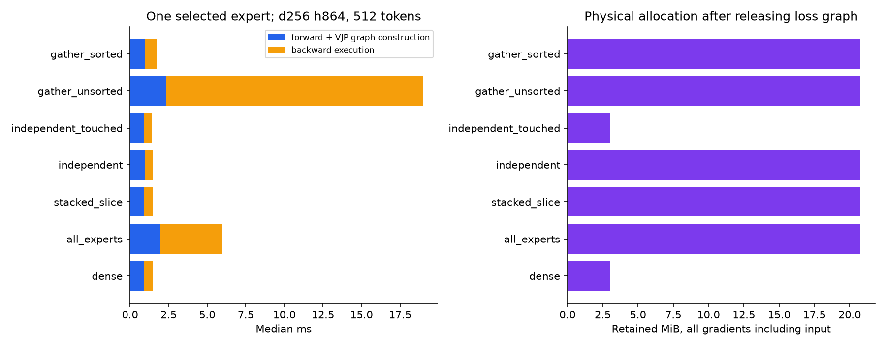
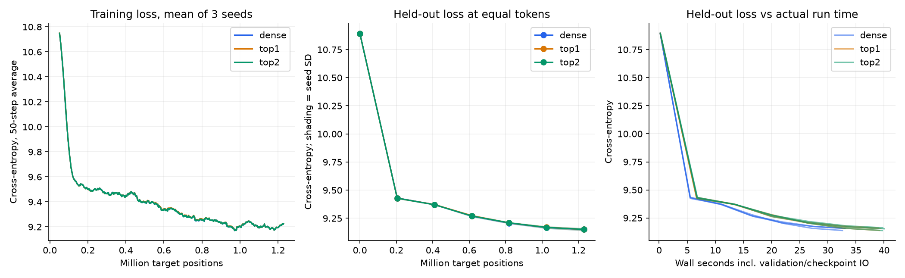
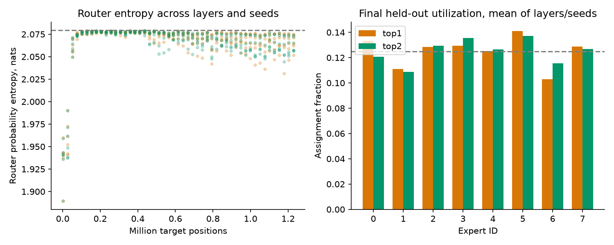
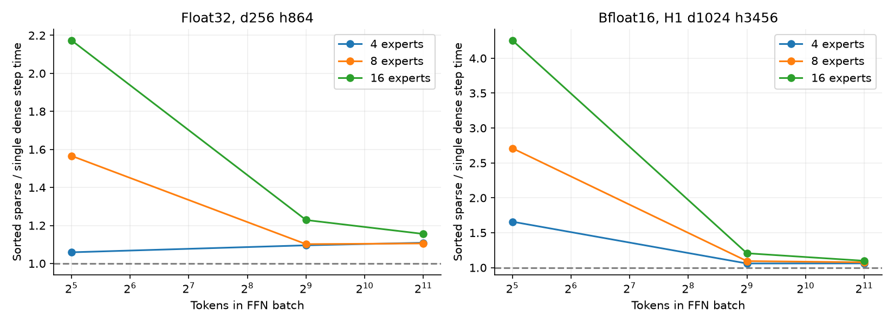

> Public archival copy. Paths and operational metadata were sanitized; original decisions and numerical failures are retained. See the root REPRODUCIBILITY.md for export and reproduction limits.

# MoE Night Results

## Executive answer

**D. RESEARCH — sparse arithmetic works, but ordinary MLX autodiff and AdamW keep dense expert gradients/state. Do not scale this into the main model yet.**

1. **Forward compute:** yes, relative to executing all experts. At H1 FFN width, 512 tokens, eight experts, sorted Top-1 is about 4 ms versus 35 ms for dense execution of all eight. It is slightly slower than one ordinary dense FFN at comparable active compute.
2. **Backward compute:** selected expert GEMM arithmetic is sparse with independent dispatch or sorted gather_mm. Full-shaped gradient writes remain. Stacked Python slices introduce large extra backward allocation/accumulation costs.
3. **Memory:** activation-related intermediates decrease relative to all-expert execution; ordinary parameter gradients do **not** become sparse. Direct nn.Module measurements retain 20.25 MiB of expert gradients versus 2.531 MiB when only one expert subtree is differentiated. An exploratory custom VJP also reaches 2.531 MiB by returning broadcast zeros for unused independent weights. AdamW state remains full-sized. MLX allocator peaks below are not whole-machine unified-memory peaks.
4. **Layout:** independent modules improve naive dispatch but do not automatically omit unused gradients. The differentiated parameter tree matters. Sorted stacked dispatch is the best general path measured here.
5. **Best per token:** `dense` has the lowest three-seed mean held-out loss (9.150643), but the differences are small and the pilot is severely undertrained. No convincing convergence winner.
6. **Best per wall time:** `dense` at the common 32.6-second endpoint, using linear interpolation between saved validation evaluations. This is an exploratory comparison, not a measured wall-clock-hour result. No hour-long quality comparison was run.
7. **Scale recommendation:** no larger training launch. First investigate expert-local gradients/state and run a longer bounded learning experiment.

| Config | Total Params | Active Params/token est. | Steady Tok/s | Peak MLX active | Final Val Loss (mean ± seed SD) | Router Health |
|---|---|---|---|---|---|---|
| dense | 15.012M | 15.012M | 39,712 | 1.127 GiB | 9.150643 ± 0.010621 | n/a |
| top1 | 24.306M | 15.016M | 33,622 | 1.180 GiB | 9.151344 ± 0.011361 | 10/294 collapse samples |
| top2 | 24.306M | 16.343M | 33,017 | 1.225 GiB | 9.151584 ± 0.012620 | 0/294 collapse samples |

All nine runs completed: 1,200 updates × 1,024 scheduled target positions = **1,228,800 per run**, three seeds (42–44), **11,059,200 total training positions**. Actual non-PAD loss targets: 1,228,800 per run; validation 32,768. The models contain 8 layers, d256/h864, GQA 8/2, full 32,768-token vocabulary, tied embeddings, sequence 256, batch 4. Two MoE layers replace FFNs at zero-based layers 3 and 7. This is an implementation/learning pilot, not a capability evaluation.

## Most surprising finding

Independent expert modules alone do not solve gradient storage. A real nn.value_and_grad call differentiating an eight-expert module returned **24 full gradient tensors**, with seven experts' norms exactly zero, and allocator storage matched their full logical size. Differentiating just its selected expert returned **three** tensors and reduced gradient storage eightfold. AdamW additionally changed an unused expert through weight decay; skipping those updates would alter optimizer semantics.

**Exploratory custom-VJP result:** a complete SwiGLU with fixed routing to expert 0 can return all 24 logically full-shaped gradient arrays while storing unused zeros as broadcast views of one scalar. Physical retained gradient bytes fell from 21,233,664 to 2,654,212, and every gradient matched ordinary autodiff. Generic global gradient clipping preserved this compression in the probe. This is not CSR sparsity, a dynamic-router training implementation, or an optimizer-state saving.

| VJP | Physical retained grad MiB | Logical grad MiB | Grad objects | AdamW state MiB |
|---|---|---|---|---|
| Ordinary | 20.250000 | 20.250 | 24 | 40.500 |
| Custom broadcast-zero | 2.531254 | 20.250 | 24 | 40.500 |

This post-pilot probe is clearly separate from the frozen A/B/C fits. Its script and 15-repeat raw windows are saved in `scripts/custom_vjp_probe.py` and `metrics/custom_vjp_swiglu.json`. AdamW still allocates 40.5 MiB of moments in either path. Custom VJP is therefore a concrete next implementation route, not merely a hypothetical API suggestion.

## Sparse backward investigation

Controlled float32 audit: E8, d256/h864, 512 tokens, all routed to expert 0, no router. Three warmups after the first call and 15 measured repeats. Timings include host graph construction in forward; backward is incremental evaluation after loss evaluation on the same VJP graph. Input gradients are included. Physical retained storage releases the loss graph before measurement; all gradient arrays stay alive.

| Layout | Fwd ms | Bwd ms | Total ms | Weight grad objects | Logical weight grad MiB | Physical grads incl. input MiB |
|---|---|---|---|---|---|---|
| dense | 0.890 | 0.571 | 1.424 | 3 | 2.531 | 3.031 |
| all_experts | 1.938 | 4.018 | 5.923 | 3 | 20.250 | 20.750 |
| stacked_slice | 0.935 | 0.536 | 1.467 | 3 | 20.250 | 20.750 |
| independent | 0.956 | 0.514 | 1.487 | 24 | 20.250 | 20.750 |
| independent_touched | 0.928 | 0.494 | 1.452 | 3 | 2.531 | 3.031 |
| gather_unsorted | 2.343 | 16.625 | 18.836 | 3 | 20.250 | 20.750 |
| gather_sorted | 0.985 | 0.745 | 1.700 | 3 | 20.250 | 20.750 |

Stacked shapes: gate/up `[8,864,256]`, down `[8,256,864]`; independent weights: 24 arrays of `[864,256]` or `[256,864]`. Unselected expert gradients are exactly zero in the forced-routing audit. Selected-subtree results exclude unselected experts from the differentiation inputs. Balanced routing touches every expert across a batch, so even exact expert-local accumulation requires all experts' gradients in that case. Per-token sparsity is not per-batch sparsity.

The installed-version [gather_mm VJP source](https://github.com/ml-explore/mlx/blob/v0.32.2/mlx/primitives.cpp#L113) uses segmented matrix multiplication for sorted expert IDs, but returns the full expert batch shape. Its [Metal allocator](https://github.com/ml-explore/mlx/blob/v0.32.2/mlx/backend/metal/matmul.cpp#L3037) allocates out.nbytes. Empty segments skip expert multiply iterations while still writing zero output tiles. Unsorted dispatch instead forms per-assignment gradient products before scatter-add; the 512-token float32 microbenchmark reached hundreds of MiB of intermediates. Source, unevaluated DOT graphs, exact norms, physical allocator deltas, and numerical equivalence support the conclusion together; timing alone is insufficient.

Equivalence tests compared forward, all parameter gradients, and input gradients against explicit expert loops for Top-1/Top-2 and imbalanced/balanced routing. Maximum float32 discrepancy was 4.8e-07; central finite differences agreed. Top-1 and Top-2 router task gradients are nonzero after detaching discrete indices. See `metrics/verification.json`.



## Training curves



Initialization is shared tensor-for-tensor within each seed (hashes verified); every MoE expert starts as a clone of its corresponding dense FFN. Router weights are independently initialized. Both Top-K modes use selected probabilities from the **full softmax**, without selected-only renormalization. Thus initial residual magnitudes differ from dense and from normalized Mixtral-style gating. This is an active-compute comparison with larger MoE capacity, not equal-total-parameter fairness. Cloned experts can delay specialization.

All runs use AdamW (.9,.95), weight decay 0.1, gradient clipping 1, LR 3e-4, 60-step warmup, cosine to 0.1×, float32. Run order is counterbalanced across seeds. Data and source were hashed and frozen before fits. Training samples 300 distinct blocks from each of 16 evenly spaced original v7 packed shards; validation is 128 eligible held-out documents from a deterministic uniform candidate sample. Validation contains 107 FineWeb-Edu and 21 FineMath documents; it does not assess every training domain. This old v7 corpus is not the current Fedora v2 mixture. Original split is preserved; exact window overlap is zero, semantic deduplication was not redone.

Paired final MoE-minus-dense loss deltas by seeds 42/43/44: Top-1 -0.002619, +0.004419, +0.000301; Top-2 -0.003584, +0.006756, -0.000351. Treat these tiny differences skeptically: three seeds, 32K held-out targets, and only ~0.08 tokens per active parameter. No test of assistant capability or expert specialization was performed. An hour of learning quality cannot be inferred from these short runs.

| Config | Forward ms | Backward ms | Clip/optimizer ms | Step ms | Final validation wall sec |
|---|---|---|---|---|---|
| dense | 6.28 | 12.89 | 6.20 | 25.40 | 32.91 |
| top1 | 7.42 | 13.18 | 9.95 | 30.49 | 39.23 |
| top2 | 7.78 | 13.97 | 9.30 | 31.02 | 39.83 |

Timings are means of per-run steady medians after update 60. Throughput divides total scheduled steady tokens by summed phase time. Actual wall curves include validation and checkpoint IO. Synchronization, eager graph construction, monitoring and a full vocabulary head limit extrapolation to compiled production throughput. First calls and repeated timing windows are saved separately; training warmup includes the LR warmup, and should not be read as compilation time.

## Router behavior



Router records include probability entropy, assignment entropy, every expert's utilization, coefficient of variation, max/min load, auxiliary loss, router/expert gradient norms, collapse flags and zero dropped/overflow tokens. Assignment fractions count Top-2 assignments and sum to 1. Counts are fractions times batch tokens × k; all assignments are executed without capacity truncation. Gradient norms are after global clipping. Load balancing coefficient is 0.01, with detached assignment fractions. Healthy utilization does not demonstrate semantic specialization. Per-layer, per-seed, per-batch records are retained, rather than only the aggregate bar plot.

Top-1 triggered **10/294** sampled layer/batch collapse flags. The worst assigned **96.6%** to one expert; the last recorded flag occurred at update 475. At final held-out evaluation, the largest individual expert batch share was 61.7%. Top-2 had no collapse flags in these samples. The flags show intermittent concentration, not demonstrated permanent global collapse; aggregation can hide it, and sparse sampling cannot exclude events between logs.

All eight experts were touched in **66.7% of Top-1** and **85.4% of Top-2** sampled layer/batches. Median touched count was 8 for both. The custom-VJP eightfold storage reduction applies to the forced-one-expert case; it cannot eliminate gradients for experts that actually received other tokens in the same batch. Exact assignment counts are saved in `metrics/router_history.jsonl`.

## Hardware bottlenecks

H1-width FFN (d1024/h3456), bfloat16, E8, 512 tokens, balanced Top-1, steady synchronized VJP timing:

| Execution | Forward ms | Backward ms | Total ms | Incremental peak MiB |
|---|---|---|---|---|
| dense | 1.62 | 1.97 | 3.61 | 60.3 |
| all_experts | 8.26 | 26.37 | 34.62 | 1122.9 |
| stacked_slice | 3.22 | 16.08 | 19.30 | 1025.3 |
| independent | 3.27 | 4.30 | 7.67 | 220.0 |
| gather_sorted | 1.95 | 2.09 | 4.02 | 197.0 |

Sorted dispatch routes and gathers token rows on GPU, groups selected matrices, uses segmented backward, and restores token order. Routing itself costs about0.18–0.23ms at d256 with 512–2048 tokens in the isolated measurements. Naive Python grouped dispatch has multiple launch/graph overheads; slicing stacked weights additionally incurs full-shaped gradient construction and accumulation. The unsorted gather path is not a suitable training baseline. No unsorted H1-width large-token test was attempted because its predicted intermediates were needlessly large.

Sorted H1-width Top-1 step milliseconds versus expert count and total token batch:

| Experts | 32 tokens | 512 tokens | 2048 tokens |
|---|---|---|---|
| 4 | 2.46 | 3.87 | 11.16 |
| 8 | 4.12 | 3.97 | 11.32 |
| 16 | 6.50 | 4.39 | 11.57 |

At 32 tokens, the ordinary dense FFN is ~1.5ms and expert fragmentation/state writes dominate. At 512 and 2048 tokens sorted Top-1 is close to the single-dense active-compute baseline, but never a clear speed win in this sweep. There is no universal width/expert crossover established by three widths/count windows. Top-2 increases actual routed tokens and transient work; use its learning benefit, not capacity alone, to justify it.

The compiled sorted-dispatch probe changed routing IDs on every call and traced **1** time(s) at fixed shapes: first call 2.98ms, steady median 0.82ms. Static-shaped GPU indices compile efficiently here. Python host routing with variable token groups was not compiled; no general claim about arbitrary dynamic expert modules follows.



## Failed experiments

- Initial Top-1 training smoke refused VJP through integer gather indices. Fixed before fits by stop_gradient on the discrete Top-K selection; gate probabilities still differentiate. Failure log and partial smoke metrics preserved.
- Initial memory audit retained the loss's forward graph, inflating the gradient delta; v2 releases it and adds a gradient-only measure. Original v1 output is retained, not used for the storage conclusion.
- Original DOT export occurred after evaluation and showed only leaves; repaired to export unevaluated graphs outside timed windows.
- All 92 sweep cases and 14 corrected primary cases completed without OOM. No queued fit crashed or timed out. Optional Default MoE and ProbMoE were researched, not run; faithful ports need separate tests, especially EMA semantics and nested marginal derivatives. Plans and primary links: `RESEARCH_NOTES.md`.

## Recommended next experiment

Keep the next model at **8 layers, width256, FFN864, eight experts every fourth FFN, Top-1**, total 24.306M / active 15.016M parameters. Observed MLX active peak is about 1.18 GiB; allow roughly 3–4 GiB process/cache headroom and retain the 16 GiB guard. Expected whole-machine memory includes macOS and other jobs, which this allocator metric excludes.

Generalize the measured broadcast-zero custom VJP from fixed expert 0 to changing touched expert sets, preserve input/router VJPs, and verify multi-step AdamW equivalence. Compare it with expert-local differentiation/state on controlled touched sets, then train the same architecture for **10–30M fresh tokens per configuration**, at least three seeds, with a domain-stratified held-out set and equal residual/gating initialization controls. Include sorted stacked versus independent selected-subtree paths when only a subset is touched. Record how frequently all experts are touched at realistic batch sizes; it limits memory savings. Do not launch the 20-layer MoE or replace the current H1 production model based on this pilot.

Custom VJPs can customize arithmetic and, with broadcast-zero views for independent weights, physically compress unused gradients without changing logical shapes. No general sparse gradient data type was implemented. Selected-subtree VJP is another measured proof of concept. Expert-ID/local-gradient buffers plus a dedicated optimizer look feasible; exact AdamW equivalence requires handling momentum decay and weight decay on untouched experts. Low-rank dW factors are possible for small token groups, but elementwise Adam state breaks a simple exact low-rank update. Details and limits are in `RESEARCH_NOTES.md`.

## Exact commands to reproduce

Run from `/RESEARCH_ROOT`. Dependencies are pinned in `configs/requirements.lock`. Existing outputs are protected by exclusive creation. Use the reproduction script to create a fresh output directory with the exact frozen source/data:

```sh
.venv/bin/python research/moe-night/results/2026-10-04/scripts/reproduce.py
```

The reproduction script prints its new directory and executes verification, primary/sweep benchmarks, the nine bounded fits, and this analysis. Dataset/weights remain on SHUTTLE; its bounded data slice is reused after hash verification. Logs, JSONL, configs, CSV summaries, graphs, plot source and checkpoint links remain under the new result directory. To rebuild only current plots/report:

```sh
.venv/bin/python research/moe-night/results/2026-10-04/scripts/analyze.py
```

macOS 27.0.1 (26A434); Apple M4 Max 128 GiB; MLX 0.32.2; Python 3.11.17. Original BoothGPT commit 3bdd2fc28761ad1fa4b8de1dcf03d888c6719165; isolated experiment source commit 2f4fe22. Original research/checkpoints/jobs were not modified. Raw environment, initial process snapshot, source status, freeze hashes, source references, and per-run memory preflights are saved. Memory-pressure readings stayed healthy at each run boundary; no existing processes were killed.

**D. RESEARCH — investigate sparse gradient/state interfaces before scaling.**
