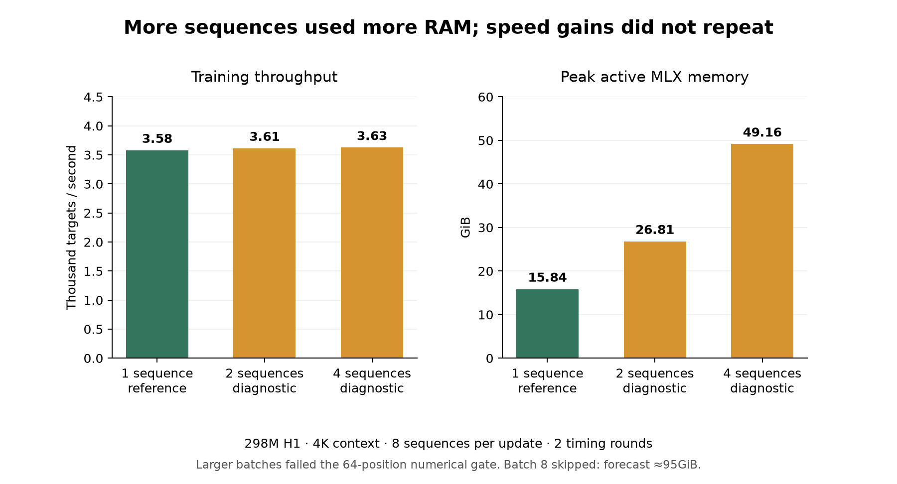

> Public archival copy. Paths and operational metadata were sanitized; original decisions and numerical failures are retained. See the root REPRODUCIBILITY.md for export and reproduction limits.

# MLX sequence batching: October 5 night results

**More RAM did not produce a repeatable training-speed gain for this 298M/4K recipe.** Neither batch 2 nor batch 4 reached the registered 5% gain in both rounds; neither reached the 10% strong-gain threshold. Their aggregate throughput gains were about 1%, while active memory rose sharply. Keep the previously tested batch-1, no-checkpointing recipe as the working benchmark reference.

## Throughput and active memory

All arms used MLX 0.32.3, composed FP32 loss, no activation checkpointing, the same eight sequences per optimizer update and an 80GiB allowance with a 1GiB buffer cache. Each of six fresh processes had three warmup and five measured updates. Aggregate throughput is targets divided by mean measured update duration, not the arithmetic mean of per-update rates.

| Sequences together | Accumulation passes | Aggregate targets/s | Aggregate gain vs batch 1 | Peak active GiB |
|---|---:|---:|---:|---:|
| 1 | 8 | 3,578 | +0.00% | 15.84 |
| 2 | 4 | 3,613 | +0.97% | 26.81 |
| 4 | 2 | 3,626 | +1.33% | 49.16 |

| Candidate | Round 1 gain | Round 2 gain | Registered useful / strong decision |
|---|---:|---:|---|
| Batch 2 | +2.02% | -0.15% | Neither |
| Batch 4 | +5.50% | -2.85% | Neither |

The batch-1 baseline itself moved from 3,436 to 3,734 targets/s between rounds (+8.67%). Batch 4 was nearly unchanged at 3,625/3,627 targets/s. The candidate gains are therefore smaller than the observed baseline drift. These short sequential windows do not identify its cause; normal background work, run order and coarse thermal/clock behavior limit attribution. The registered reverse order prevents treating the favorable first round as a confirmed gain.

## Numerical and capacity outcomes

Every checked parameter gradient was finite and nonzero. All 48 training updates produced finite losses/norms; first and final master/model/optimizer states were finite, and actual master-weight changes were verified. Initial full-model and input hashes matched in all six timing workers and both validation workers.

| Context inputs | Physical batch | Absolute loss difference | Gradient relative L2 | Registered gate |
|---|---:|---:|---:|---|
| 64 | 1 | 0 | 0 | PASS |
| 64 | 2 | 0.00035727024 | 0.01179004 | FAIL |
| 64 | 4 | 0.00035703182 | 0.011825139 | FAIL |
| 64 | 8 | 0.00035703182 | 0.011613248 | FAIL |
| 4095 | 1 | 0 | 0 | PASS |
| 4095 | 2 | 4.7683716e-07 | 0.0023510628 | PASS |
| 4095 | 4 | 2.3841858e-07 | 0.0023634547 | PASS |

The limits remain absolute loss difference ≤2e-4 and global gradient relative L2 ≤0.005. Batches 2 and 4 pass at the actual 4095-position context but fail at context 64. Their speed records remain diagnostic because both registered gates are required. This is a strict numerical-matching rejection; no real-data learning degradation or parity was established. No tolerance was loosened, and no optional FP32 diagnostic was needed for the speed decision.

Batch 8 was **not attempted at full context**. The registered forecast, peak(B4) + 2 × [peak(B4) − peak(B2)], was 94.97GiB, above the 76GiB forecast threshold inside the 80GiB budget. This is a conservative forecast-based skip, not an observed OOM or measured batch-8 memory peak. The forecasting peaks include the retained reference gradient; headline timing peaks above do not. Batch 8's short-context check failed the numerical limits.

## What this means for using spare Mac RAM

The prior study found about 14% higher throughput by keeping activations instead of recomputing them, at 15.84GiB active memory. That useful memory tradeoff was already enabled in every arm here. Raising an allocation allowance alone does not add compute or memory bandwidth. Larger physical batches consumed more working memory, but the measured speed gains did not repeat. This campaign supports the existing batch-1 reference; it does not demonstrate that allocating 80GiB makes pretraining faster.

All inputs were fresh seed-42 model initialization and fixed synthetic sequences from NumPy seeds 500..507, repeated only for this timing/correctness test. Model geometry: 298,361,856 parameters, 20 layers, width 1024, intermediate size 3456, GQA 8/2, tied vocabulary 32768, RoPE 500000. BF16 model/backward; FP32 masters, accumulation and optimizer state; clipping 1; Muon/AdamW learning rates .00015/.00006. The imported prior Mac optimizer equations differ from Fedora production. This is not a new matched CUDA comparison or a real-data quality test.

Initialization, compilation/warmup, full-tensor finite scans and identity hashing are excluded from steady timing. Microbatch materialization, float loss reads and the new per-microbatch memory guard are included; the guard writes a small live-memory record. This instrumentation cost varies with the number of accumulation passes, so small differences should not be treated as pure GPU-kernel effects. No pipeline, loss, precision, optimizer-equation or effective-batch changes were combined with this sweep.

## Safety, preservation and incidents

Mac remained on AC. Recorded thermal state was nominal/fair, never serious/critical; minimum recorded memory-pressure free percentage was 65%. The maximum within-worker monitor gap was 1.604s. Worker wall time totaled 480.53s of the 1800s cap; the campaign took 557.57s of the 5400s cap, including cooldowns. All 86 pinned paths verified after completion, and no campaign GPU/Python process remains. Numerical temperature sensors were unavailable; no temperatures are invented.

Battle.net was established idle and quit through normal Command-Q, with closure verified. Other apps were left open where idle/unsaved state could not be established. Active work, services, original/candidate environments, production and other training hosts were preserved. No weights, input arrays or tensor sample payloads were saved; the records contain identities, timings and scalar error statistics.

The initial broad process inventory included a background worker credential in tool output. It was not copied into campaign artifacts or Git. Subsequent inventories use safe executable/process summaries and omit arbitrary arguments. Details without credential content are retained in PREFLIGHT_INCIDENT.md.

## Evidence and follow-up

- PLAN.md and IMPLEMENTATION.md: original contract and pre-run implementation details.
- FREEZE.json: 86 pinned source/environment/contract paths; freeze commit db9fb81.
- SUMMARY.json: complete aggregate and paired calculations.
- FINAL_VERIFICATION.json: independent process, identity, freeze, safety and budget audit.
- NUMERICAL_NOTES.md and metrics/validation_64.json / validation_4095.json: unchanged gate and capacity results.
- metrics/B1_R1.json through B4_R2.json: all 48 update records, with no tensor payloads.
- metrics/events.jsonl: worker commands, monitor samples, cooldowns and completion.
- logs/: preserved stdout/error records, ignored in Git.
- BoothGPT Mac-role notes receive a dated outcome entry; the one-off scheduled follow-up is paused after this attempt.

No production deployment or further overnight training is part of this result.
